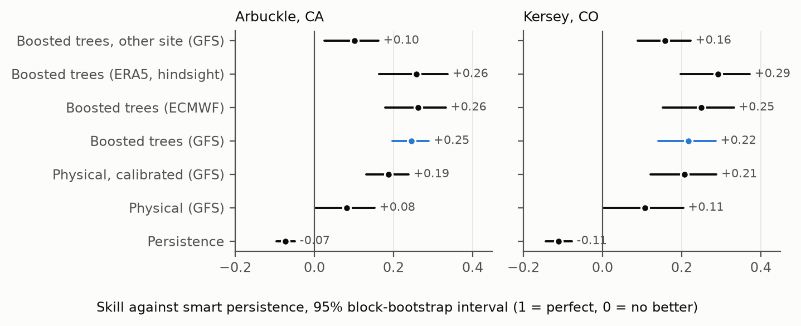

# How much of a solar forecast is skill?

A reproducible two-site study of day-ahead PV forecasting from public data: how much learned models add over honest baselines, how much of it travels to another plant, and where it breaks.

Working paper v1, 23 October 2026, not peer reviewed: [`paper/solar-two-sites-v1.pdf`](paper/solar-two-sites-v1.pdf). Site page: <https://speyyman.github.io/research/solar-two-sites/>.



## What it found

Two public plants from NREL's PVDAQ archive (a 893 kW fixed array in Arbuckle, California, and a 4,738 kW single-axis tracker in Kersey, Colorado), weather forecasts as they were issued a day ahead (GFS and ECMWF, archived by Open-Meteo), and ERA5 as hindsight weather. Scored on the same daytime hours with a monthly rolling origin.

| | Arbuckle | Kersey |
|---|---|---|
| Smart persistence, nRMSE of AC rating | 0.194 | 0.232 |
| Physical model, calibrated (skill) | +0.19 | +0.21 |
| Boosted trees on GFS (skill, 95% interval) | +0.25 (+0.20 to +0.29) | +0.22 (+0.14 to +0.29) |
| Boosted trees on ERA5, hindsight (skill) | +0.26 | +0.29 |
| Boosted trees trained on the other site (skill) | +0.10 | +0.16 |
| 80% interval coverage | 59% | 65% |

A physical model with two fitted numbers does most of the work; at Kersey the trees add nothing measurable over it. Hindsight weather from the reanalysis would help Kersey somewhat and Arbuckle hardly at all. A model from the other plant keeps less than half the gain at Arbuckle. The intervals are too narrow. Read one by one, many of the largest misses are not weather-forecast errors at all: zero output on clear days, an inverter off for a week, a summer of clear dry days at reduced output.

## Quick start

Python 3.12 or newer (developed on 3.14).

```sh
python -m venv .venv
. .venv/bin/activate            # Windows: .venv\Scripts\activate
pip install -e .[dev]
python -m pipeline all          # fetch (about 30 MB), clean, run, failures, figures, report
pytest
```

The full run takes a few minutes. It rewrites `results/`, `figures/` and `paper/generated/`; with unchanged inputs `git diff` shows nothing. To build the PDF, install [Tectonic](https://tectonic-typesetting.github.io/) and run `make paper` (or `cd paper && tectonic main.tex`).

## How it works

| Step | Module | Does |
|---|---|---|
| `fetch` | `pipeline/fetch.py` | Downloads the PVDAQ files and the Open-Meteo responses; stops if any differs from the SHA-256 in `data/manifest.json` (set `UPDATE_MANIFEST=1` to accept new data on purpose) |
| `clean` | `pipeline/clean.py` | Converts every clock to UTC, checks it against solar noon, applies the cleaning rules, hourly means; writes the ledger of every value dropped, shifted or filled (`results/ledger_clean.csv`) |
| `run` | `pipeline/evaluate.py`, `features.py`, `physical.py`, `models.py` | Builds features available at issue time (end of D-1), runs persistence, smart persistence, the pvlib physical model, its calibrated version, LightGBM point and quantile models and the cross-site transfer, month by month; block bootstrap; `results/metrics.json` |
| `failures` | `pipeline/failures.py` | Daily errors, clearness indices from the plant, the forecast and ERA5; sorts large misses by fixed rules; plant-anomaly sensitivity check |
| `figures` | `pipeline/figures.py` | Paper figures (`figures/*.pdf`, `*.png`) and site figures (`figures/site/*.svg`) |
| `report` | `pipeline/report.py` | Every number in the paper as a LaTeX macro (`paper/generated/numbers.tex`), tables, and `results/summary.json` |

`scripts/check_numbers.py <file>...` lists every number in a piece of writing that is not a value in `results/summary.json`; it was run on the site's paper page and essay, and what it lists there are dates, plant IDs and definitions.

Leakage guard: every table the pipeline builds is checked so that persistence inputs come only from strictly earlier days, and a synthetic end-to-end test plants a leak and confirms it is caught.

Data sources, licences and the exact queries are in [`DATA.md`](DATA.md).

## Limitations

Two plants, neither a cloudy humid site. Kersey has 16 months, ten of them scored. The first test month has about five and a half months of training history. Weather is hourly at one grid point. Plant faults are inferred from power, power factor and weather; without maintenance logs the failure categories are descriptions, not diagnoses. Hyperparameters were fixed in advance, not tuned. The Open-Meteo archive is a third-party record of past runs; the checksums would show a change but cannot prevent one. Details are in the paper.

This is a new, independent study. It shares no code, data or analysis with the author's earlier team capstone on solar yield.

## Licence

Code: MIT ([`LICENSE`](LICENSE)). Paper text and figures: CC BY 4.0 ([`LICENSE-paper.md`](LICENSE-paper.md)). Data remain under their own licences ([`DATA.md`](DATA.md)). How to cite: [`CITATION.cff`](CITATION.cff).

The analysis code and drafting were done with Claude (Anthropic) under the author's direction.
